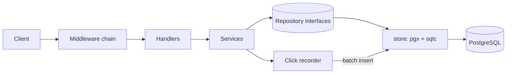

# Architecture

This document explains how the parts fit together and why each technical choice was made. Requirements are in `PRD.md`.

## 1. Overview

One Go binary, one PostgreSQL database. No other services.



## 2. Layers and dependency rule

Dependencies point inward. Inner layers never import outer layers.

| Layer | Responsibility | Knows about |
| --- | --- | --- |
| Handler | Decode request, call service, encode response. No business rules. | HTTP, service |
| Service | Business rules, validation, ownership checks, transactions. No HTTP types. | Repository interface, domain types |
| Repository (interface) | Defined in the service package, next to its consumer. | Domain types |
| Store | Implements repositories with sqlc. Translates DB errors to domain errors. | pgx, sqlc, domain types |

Rule of thumb: if a service file imports `net/http`, or a handler file imports `pgx`, the design is wrong.

Interfaces are small and defined by the consumer ("accept interfaces, return structs"). The service package declares only the methods it uses.

## 3. Packages

| Package | Role |
| --- | --- |
| `cmd/api` | `main`. Loads config, calls `app.Run`, exits with the right code. |
| `internal/app` | Composition root. Builds all dependencies by hand, registers routes, runs the server, orchestrates shutdown. |
| `internal/config` | Typed config struct loaded from env, validated at startup. |
| `internal/auth` | User registration, login, token issue and verify, auth middleware. |
| `internal/link` | Link model, service, handler. Code generation and URL validation. |
| `internal/click` | Click event type, async recorder, stats service and handler. |
| `internal/store` | PostgreSQL repositories. Generated sqlc code lives in `internal/store/sqlc`. |
| `internal/httpx` | Middleware, problem+json, JSON decode and encode helpers, cursor helpers. No domain imports. |

Package per domain, not per technical layer. Avoid `models/`, `controllers/`, `utils/`, and `common/`.

## 4. Data model

```text
users
  id            uuid        pk, default gen_random_uuid()
  email         citext      unique, not null
  password_hash text        not null
  created_at    timestamptz not null default now()

links
  id          uuid        pk, default gen_random_uuid()
  user_id     uuid        not null, fk users(id) on delete cascade
  code        text        unique, not null
  target_url  text        not null
  expires_at  timestamptz null
  created_at  timestamptz not null default now()
  index (user_id, created_at desc, id desc)

clicks
  id          bigint      pk, generated always as identity
  link_id     uuid        not null, fk links(id) on delete cascade
  clicked_at  timestamptz not null
  index (link_id, clicked_at)
```

Click stats are computed with `count` and `group by date` on `clicks`. A denormalized `click_count` column is a later optimization.

## 5. Request lifecycle

Middleware order, outermost first:

1. Recover: turns panics into `500` problem JSON and logs the stack.
2. Request ID: reads or generates `X-Request-ID`, stores it in the context.
3. Access log: one `slog` line per request with method, path pattern, status, duration, request ID.
4. Timeout: wraps the request context with `REQUEST_TIMEOUT`.
5. Rate limit: per client IP token bucket.
6. Auth (protected routes only): verifies the JWT and puts the user ID in the context.

Context flows from the request into services and then into every database call. If the client disconnects or the timeout fires, the query is cancelled.

## 6. Error model

- Each domain package defines sentinel errors, for example `link.ErrNotFound`, `link.ErrCodeTaken`.
- Lower layers wrap with `fmt.Errorf("create link: %w", err)`. Callers use `errors.Is` and `errors.As`.
- Only `httpx` maps errors to HTTP status codes and problem JSON. Unknown errors become `500` with a generic message. Details go to the log, not the client.
- Store translates PostgreSQL error code `23505` (unique violation) to `ErrCodeTaken` or `ErrEmailTaken`.

Problem JSON shape:

```json
{
  "type": "about:blank",
  "title": "Conflict",
  "status": 409,
  "code": "code_taken",
  "detail": "custom code is already in use",
  "request_id": "b1c2..."
}
```

## 7. Click recording (async)

```text
redirect handler -> recorder.Record(event)    non-blocking
                         |
                   buffered channel (CLICK_BUFFER_SIZE)
                         |
                   one worker goroutine
                         |  flush when 100 events or every 1 second
                   store.InsertClicks(batch)
```

- `Record` uses `select` with a `default` branch. If the buffer is full, the event is dropped and a counter is incremented. The redirect never waits.
- The worker stops when the channel is closed, after flushing what is left.
- A recorder is owned by `app`. It has `Start`, and `Close(ctx)` which waits for the worker or the context deadline.

## 8. Graceful shutdown order

On `SIGINT` or `SIGTERM` (`signal.NotifyContext`):

1. Mark the process as not ready (`/readyz` returns 503) so the load balancer stops sending traffic.
2. `http.Server.Shutdown(ctx)`: stop accepting, wait for in-flight requests.
3. `recorder.Close(ctx)`: flush buffered clicks.
4. Close the database pool.

All steps share one `SHUTDOWN_TIMEOUT` deadline. Order matters: the recorder must outlive the HTTP server, and the pool must outlive the recorder.

## 9. Security notes

- Passwords: `bcrypt`, cost 12. Same error for unknown email and wrong password.
- JWT: HS256, secret at least 32 bytes, short TTL, `exp` and `iat` validated, algorithm pinned on verify.
- Only `http` and `https` target URLs. This blocks `javascript:` and `data:` links.
- Ownership failures return `404`, not `403`, so link existence is not leaked.
- Body size limit with `http.MaxBytesReader`. JSON decoder uses `DisallowUnknownFields`.
- Parameterized queries only (sqlc guarantees this).

## 10. Decisions and trade-offs

Each row says what we chose, what else was possible, the cost of our choice, and when to revisit.

| Topic | Choice | Alternatives | Trade-off | Revisit when |
| --- | --- | --- | --- | --- |
| Router | stdlib `ServeMux` (Go 1.22 patterns) | chi, Gin, Echo | No dependency, standard `http.Handler`. No built-in route groups, so a small middleware helper is written by hand. | Many route groups or per-route middleware make the helper painful. chi is the first step up. |
| Package layout | Package per domain under `internal/` | Layers (`controllers/`, `models/`) | Related code stays together and a domain can be split out later. Some boilerplate repeats per domain. | Almost never. |
| Architecture depth | Handler, service, repository. Interfaces on the consumer side. | Full hexagonal with ports and adapters for everything | Enough separation to test without over-engineering. | Several delivery mechanisms appear (gRPC, queue consumers) using the same services. |
| Data access | `pgx` + `sqlc` | GORM, sqlx, ent | SQL is explicit and checked at generation time, easy to optimize. You must write SQL and run a generator. | Very dynamic queries are needed. Then add a query builder for those only. |
| Migrations | `goose` with SQL files | golang-migrate, atlas | Plain SQL, simple. No automatic schema diff. | Team wants declarative schema management. |
| IDs | UUID for users and links | bigint identity | Not guessable, safe to expose. Bigger indexes. Pagination needs `(created_at, id)`. | Index size or insert rate becomes a problem. |
| Short code | Random base62, 7 chars, `crypto/rand`, retry on conflict | Counter plus base62, URL hash | Not guessable. Needs a retry loop. 62^7 is about 3.5 trillion codes. | Collision rate gets high. Then lengthen the code. |
| Pagination | Keyset cursor `(created_at, id)`, opaque base64 | Offset and limit | Stable and fast on large tables. No "jump to page N". | Product needs page numbers. |
| Auth | JWT HS256 access token, short TTL | Server sessions, OIDC provider | Stateless and simple. Cannot revoke a token before it expires. No refresh flow. | Need logout-everywhere, roles, or SSO. Move to OIDC. |
| Errors | Sentinel errors, `%w`, RFC 9457 problem JSON | Custom error structs everywhere | Standard Go and a standard HTTP error format. Mapping table must be kept in sync. | Many error types with rich data appear. |
| Logging | `log/slog`, JSON in production | zap, zerolog | In stdlib, structured, leveled. A bit slower than zerolog, irrelevant here. | Profiling shows logging is a hotspot. |
| Config | Env vars into a typed struct (`caarlos0/env`) | viper, config files | 12-factor, tiny dependency. No hot reload. | Need dynamic or file-based config. |
| Dependency injection | Manual constructors in `app` | wire, fx | Explicit and easy to follow. `app` grows as the project grows. | Wiring becomes hundreds of lines. Try wire. |
| Click recording | Buffered channel and one batching worker | Insert in the request, Kafka or queue | Redirect latency is unaffected. Clicks can be lost on crash or when the buffer is full. | Click data becomes billing-grade. Use a durable queue. |
| Redirect status | `302` | `301` | Browsers do not cache it, so every click is counted and deletes take effect. Slightly more load. | Counting no longer matters and links are permanent. |
| Rate limiting | In-memory token bucket per IP (`x/time/rate`) | Redis, gateway-level | No extra infrastructure. Not shared between instances. Behind a proxy, client IP must come from a trusted header. | More than one instance. Move to gateway or Redis. |
| Tests | stdlib `testing`, real PostgreSQL via testcontainers | Mock the database, sqlmock | Tests catch real SQL and migration bugs. Slower than mocks and need Docker. | CI cannot run Docker. |
| Observability | Request ID, structured logs. Prometheus metrics and OpenTelemetry as stretch goals. | Full tracing from day one | Simple first. Less visibility until stretch goals are done. | Service count grows beyond one. |

## 11. Future evolution

Ordered by likelihood:

1. Prometheus `/metrics` and OpenTelemetry tracing.
2. Idempotency-Key support on `POST /v1/links`.
3. Cache for redirect lookups (in-process LRU first, Redis later).
4. Refresh tokens and logout.
5. Split the click recorder into a separate consumer reading from a queue.
