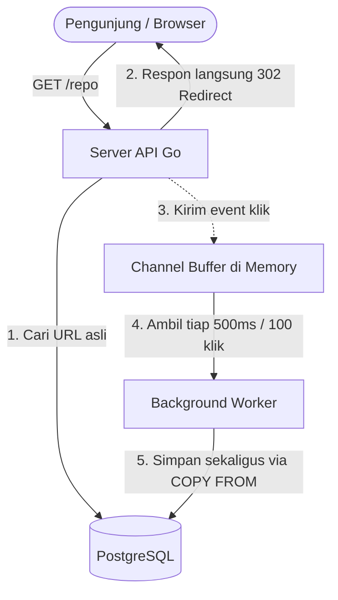

# Panduan Lengkap Shortlink

Dokumen ini menjelaskan apa itu proyek Shortlink, cara kerjanya, letak dan fungsi setiap folder, daftar fitur, serta tutorial cara menggunakannya.

---

## 1. Apa Itu Shortlink?

Shortlink adalah aplikasi backend REST API pemendek URL (seperti *Bitly* atau *TinyURL*) berstandar industri (*production-grade*) yang dibuat menggunakan bahasa **Go (Golang)** dan database **PostgreSQL**.

### Masalah yang Diselesaikan
- URL website sering kali terlalu panjang dan sulit dibagikan di media sosial, pesan chat, atau materi presentasi.
- Pemilik tautan ingin mengetahui apakah tautan mereka dibuka orang dan berapa banyak klik yang didapat.

### Solusi Shortlink
- Menerima URL panjang (contoh: `https://github.com/kyyril/shortlink/blob/main/README.md`).
- Menghasilkan URL pendek dengan kode 7 karakter acak (contoh: `https://shortlink-production-1c53.up.railway.app/abc1234`) atau kode kustom pilihan pengguna (contoh: `.../repo`).
- Ketika kode diakses, sistem langsung mengalihkan pengunjung (*redirect* `302 Found`) ke URL asli dalam waktu beberapa milidetik.
- Sistem mencatat data kunjungan (analitik klik) di latar belakang (*background worker*) tanpa memperlambat proses *redirect*.

---

## 2. Cara Kerja Sistem



1. **Autentikasi**: Pengguna mendaftar dan masuk untuk mendapatkan token JWT. Hanya pemilik tautan yang bisa melihat daftar tautan, melihat statistik klik, atau menghapus tautan mereka.
2. **Pembuatan Tautan**: Pemilik mengirimkan URL panjang. Sistem memvalidasi skema (`http`/`https`), memeriksa kode kustom jika diisi, atau membuat kode acak menggunakan Base62 7 karakter (`crypto/rand`).
3. **Redirect Tanpa Beban Database**: Saat tautan dibuka via `GET /{code}`, sistem mencari URL tujuan di indeks database dan langsung merespon `302 Found`. Data klik dimasukkan ke antrean memori (*in-memory channel*).
4. **Pencatatan Klik Asinkron**: Background worker mengumpulkan klik dari antrean lalu menyimpannya secara kolektif (*batch*) menggunakan PostgreSQL binary `COPY FROM` setiap 500ms atau setiap 100 klik.
5. **Idempotensi**: Mencegah pembuatan tautan ganda akibat koneksi internet yang putus-nyambung atau pengguna mengklik tombol kirim dua kali berturut-turut.

---

## 3. Struktur Folder dan Penjelasannya

Berikut adalah letak dan fungsi masing-masing direktori dalam repositori ini:

```text
shortlink/
├── cmd/
│   └── api/                  # Titik awal eksekusi program (main.go)
├── internal/                 # Kode internal aplikasi (tidak diekspor ke luar modul)
│   ├── app/                  # Perakitan router, middleware, endpoint dokumentasi, & shutdown
│   ├── auth/                 # Domain pengguna: pendaftaran, login, bcrypt, token JWT
│   ├── click/                # Domain analitik: antrean klik, background worker, dan statistik
│   ├── config/               # Pemuatan dan validasi konfigurasi variabel lingkungan (.env)
│   ├── httpx/                # Utilitas HTTP: middleware, format error RFC 9457, cursor pagination
│   ├── link/                 # Domain tautan: validasi URL, generator kode, logika idempotensi
│   └── store/                # Implementasi repository database PostgreSQL
│       └── sqlc/             # Kode Go yang dihasilkan otomatis oleh generator sqlc
├── db/
│   ├── migrations/           # Skrip migrasi skema database versi Goose (.sql)
│   └── queries/              # Kueri SQL mentah (.sql) yang dikompilasi oleh sqlc
├── api/
│   ├── openapi.yaml          # Dokumen kontrak spesifikasi OpenAPI 3.0
│   └── embed.go              # File Go untuk menanamkan openapi.yaml ke dalam binary
├── docs/                     # Dokumentasi teknis proyek
│   ├── ARCHITECTURE.md       # Arsitektur sistem, aturan dependensi, dan keputusan desain
│   ├── PRD.md                # Kebutuhan produk dan kriteria penerimaan (acceptance criteria)
│   ├── SYSTEM_DESIGN.md      # Pembahasan desain sistem skala besar untuk interview
│   ├── IMPLEMENTATION_PLAN.md# Rencana kerja bertahap dan log bukti pengujian
│   ├── TESTING.md            # Aturan dan panduan pengujian kode
│   └── PANDUAN.md            # Panduan pengenalan proyek ini
├── scripts/                  # Skrip bantuan pengujian API mandiri
├── .github/workflows/        # Konfigurasi CI/CD otomatis (GitHub Actions)
├── docker-compose.yml        # Konfigurasi Docker lokal (API, PostgreSQL, Swagger)
├── Dockerfile                # Instruksi build image Docker (multi-stage build scratch)
├── Makefile                  # Perintah pintas pengujian, format, dan build
└── README.md                 # Tampilan muka repositori GitHub
```

### Rincian Tanggung Jawab Paket `internal/`

- **`cmd/api/main.go`**: Tidak berisi logika bisnis. Tugasnya hanya membaca variabel lingkungan, menyambungkan koneksi database, merakit komponen aplikasi, dan memanggil perintah jalankan server.
- **`internal/app/`**: Pusat perakitan (*composition root*). Menentukan urutan middleware, mendaftarkan semua endpoint rute HTTP, menyajikan halaman Swagger UI di `/docs`, dan mengatur proses mematikan server secara rapi (*graceful shutdown*).
- **`internal/auth/`**: Menangani verifikasi kata sandi dengan hash `bcrypt` (cost 12) dan pembuatan token JWT HS256 dengan masa kedaluwarsa.
- **`internal/link/`**: Mengatur validasi URL, memastikan kode kustom belum dipakai pengguna lain, mengatur tanggal kedaluwarsa tautan, serta mencocokkan *header* `Idempotency-Key`.
- **`internal/click/`**: Mengelola antrean buffered channel klik dan memicu flush data ke database secara berkala.
- **`internal/store/`**: Berisi kueri database. Memetakan error kode unik PostgreSQL (`23505`) menjadi error domain seperti `link.ErrCodeTaken` atau `auth.ErrEmailTaken`.
- **`internal/httpx/`**: Standar penanganan HTTP. Mengonversi error menjadi format standar RFC 9457 `application/problem+json`, menyediakan middleware rate limiter (pembatas kecepatan per IP), dan mencatat log dengan `slog`.

---

## 4. Daftar Fitur

| Kategori | Fitur | Penjelasan |
| --- | --- | --- |
| **Keamanan & Akun** | Registrasi & Login | Akun terlindungi hash bcrypt; login menghasilkan JWT bearer token. |
| **Keamanan Jaringan** | Rate Limiter per IP | Mencegah spam dengan algoritma Token Bucket (otomatis merespon 429 jika melampaui batas). |
| **Keamanan Jaringan** | CORS Middleware | Mengizinkan integrasi API dari berbagai domain klien web. |
| **Manajemen Tautan** | Generator Base62 Acak | Membuat kode unik 7 karakter acak dari 3,5 triliun kombinasi. |
| **Manajemen Tautan** | Custom Short Code | Pengguna bisa menentukan alias sendiri (contoh: `my-portfolio`). |
| **Manajemen Tautan** | Tautan Kedaluwarsa | Menetapkan batas waktu aktif; jika lewat waktu, mengembalikan status `410 Gone`. |
| **Manajemen Tautan** | Keyset Pagination | Navigasi daftar tautan menggunakan cursor deterministik `(created_at, id)` yang cepat pada dataset besar. |
| **Keandalan** | Idempotensi Permintaan | Menerima header `Idempotency-Key` pada pembuatan tautan agar request duplikat tidak membuat data ganda. |
| **Pengalihan Cepat** | Publik 302 Redirect | Pengalihan instan ke URL tujuan tanpa menunggu proses tulis analitik database. |
| **Analitik** | Telemetri Kunjungan | Melihat total kunjungan dan grafik klik per hari selama 30 hari terakhir. |
| **Standar Error** | RFC 9457 Problem Details | Format error konsisten dengan status, kode error, detail, dan `request_id`. |
| **Observabilitas** | Health Check & Metrik | Probe `/healthz` (liveness), `/readyz` (readiness ping DB), dan `/metrics` (Prometheus). |
| **Dokumentasi** | Swagger UI Interaktif | Halaman dokumentasi API langsung di browser pada rute `/docs`. |

---

## 5. Cara Menggunakan API

Tersedia versi deployment yang sudah aktif di internet:
**URL Dasar:** `https://shortlink-production-1c53.up.railway.app`

### Cara 1: Menggunakan Swagger UI (Paling Mudah)
1. Buka browser dan kunjungi: **`https://shortlink-production-1c53.up.railway.app/docs`**.
2. Pilih server **`Production server (Railway)`** pada dropdown *Servers*.
3. Klik tombol **Authorize** (jika sudah memiliki token) atau langsung coba endpoint publik.
4. Buka salah satu endpoint (misal `POST /v1/auth/register`), klik **Try it out**, isi data JSON, lalu klik **Execute**.

---

### Cara 2: Menggunakan Terminal / cURL

#### Langkah 1: Daftar Akun Baru
```bash
curl -X POST https://shortlink-production-1c53.up.railway.app/v1/auth/register \
  -H "Content-Type: application/json" \
  -d '{"email":"user@example.com","password":"password123"}'
```
*Respon status: `201 Created`*

#### Langkah 2: Login untuk Mendapatkan Token JWT
```bash
curl -X POST https://shortlink-production-1c53.up.railway.app/v1/auth/login \
  -H "Content-Type: application/json" \
  -d '{"email":"user@example.com","password":"password123"}'
```
*Respon:*
```json
{
  "access_token": "eyJhbGciOiJIUzI1NiIsIn...",
  "token_type": "Bearer",
  "expires_in": 900
}
```
> Simpan nilai `access_token` ini untuk disertakan pada langkah selanjutnya.

#### Langkah 3: Buat Tautan Pendek Baru
Gunakan token pada header `Authorization: Bearer <TOKEN>`:

```bash
curl -X POST https://shortlink-production-1c53.up.railway.app/v1/links \
  -H "Authorization: Bearer <ISI_DENGAN_TOKEN_ANDA>" \
  -H "Content-Type: application/json" \
  -d '{
    "url": "https://github.com/kyyril/shortlink",
    "custom_code": "my-github-link"
  }'
```
*Respon status: `201 Created`*
```json
{
  "code": "my-github-link",
  "url": "https://github.com/kyyril/shortlink",
  "created_at": "2026-11-10T06:30:00Z"
}
```

#### Langkah 4: Buka Tautan Pendek
Kunjungi tautan di browser atau gunakan curl:
```bash
curl -i https://shortlink-production-1c53.up.railway.app/my-github-link
```
*Respon:*
```http
HTTP/1.1 302 Found
Location: https://github.com/kyyril/shortlink
```
Browser otomatis membuka halaman tujuan.

#### Langkah 5: Cek Statistik Klik Tautan
```bash
curl -X GET https://shortlink-production-1c53.up.railway.app/v1/links/my-github-link/stats \
  -H "Authorization: Bearer <ISI_DENGAN_TOKEN_ANDA>"
```
*Respon:*
```json
{
  "code": "my-github-link",
  "total_clicks": 1,
  "last_30_days": [
    {
      "date": "2026-11-10",
      "clicks": 1
    }
  ]
}
```

#### Langkah 6: Lihat Daftar Tautan Anda (Cursor Pagination)
```bash
curl -X GET "https://shortlink-production-1c53.up.railway.app/v1/links?limit=10" \
  -H "Authorization: Bearer <ISI_DENGAN_TOKEN_ANDA>"
```

#### Langkah 7: Hapus Tautan
```bash
curl -X DELETE https://shortlink-production-1c53.up.railway.app/v1/links/my-github-link \
  -H "Authorization: Bearer <ISI_DENGAN_TOKEN_ANDA>"
```
*Respon status: `204 No Content`*

---

## 6. Cara Menjalankan Aplikasi di Komputer Lokal

Jika ingin menjalankan aplikasi ini di laptop Anda sendiri:

### Prasyarat
- **Go 1.26+** (atau Go 1.24+)
- **Docker** dan **Docker Compose**

### Menggunakan Docker Compose (Paling Praktis)
1. Buka terminal di folder proyek ini:
   ```bash
   docker compose up -d
   ```
2. Tunggu kontainer berjalan.
3. Uji kesiapan server:
   ```bash
   curl http://localhost:8080/readyz
   ```
   *(Harus mengembalikan `{"status":"ready"}`)*
4. Buka Swagger UI lokal di:
   [http://localhost:8080/docs](http://localhost:8080/docs)

### Menjalankan Perintah Pengujian (Testing)
```bash
# Menjalankan format kode
make fmt

# Menjalankan linter
make lint

# Menjalankan unit tests dengan pendeteksi race condition
make test

# Menjalankan integration tests terhadap database PostgreSQL
make test-integration
```
