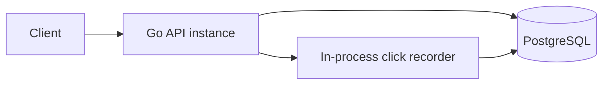
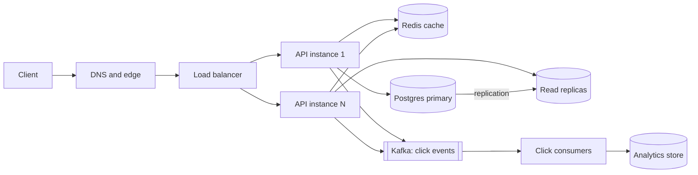
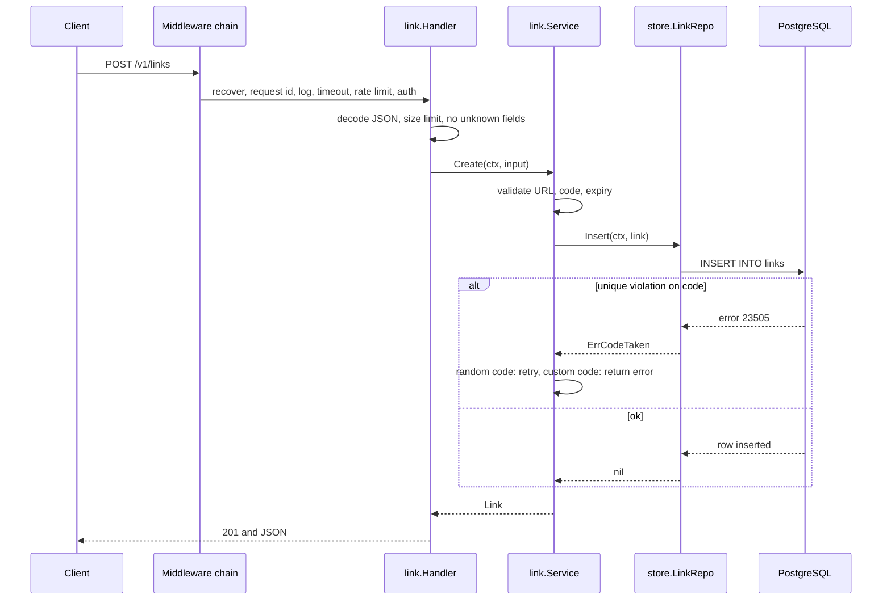
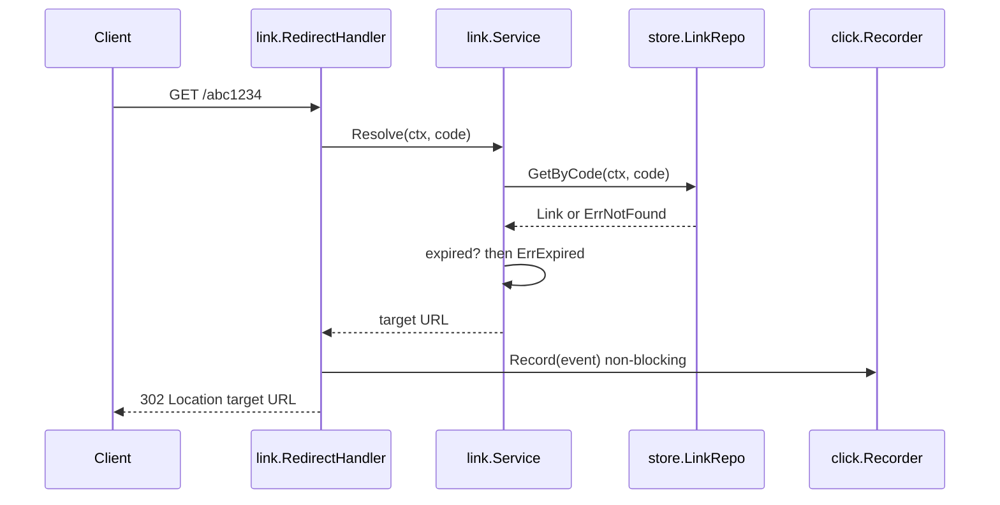
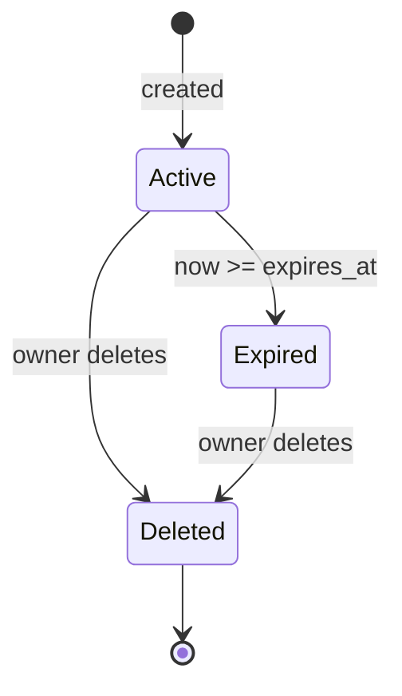

# System Design

This document walks through Shortlink from high level to low level, the way you would explain it in a system design interview.

How it relates to the other documents:

- `PRD.md` says what we build. `ARCHITECTURE.md` says how this repository is built.
- This document also covers how the design changes when traffic grows by 1000x.
- Sections 1 to 6 and 8 to 10 are background for learning. **Do not build production-scale parts (Redis, Kafka, sharding) unless `IMPLEMENTATION_PLAN.md` says so.** Section 7 (low-level design) is the guide for implementation.

## Contents

1. Requirements
2. Capacity estimation
3. API design
4. High-level design
5. Data design
6. Deep dives
7. Low-level design
8. Evolution path
9. Interview Q&A
10. The 60-second pitch

## How to run a system design interview

Follow the same order every time:

1. Clarify requirements and scope.
2. Estimate scale with simple math.
3. Define the API.
4. Design the data model.
5. Draw the high-level architecture.
6. Deep dive on the hard parts (here: code generation, redirect path, click analytics).
7. Name bottlenecks, failure modes, and trade-offs.

Say your assumptions out loud. Interviewers care more about your reasoning than the final diagram.

---

## 1. Requirements

### Functional

- Create a short link for a long URL (random or custom code, optional expiry).
- Redirect from short code to the long URL.
- Manage own links (list, view, delete).
- Count clicks and show stats.

### Non-functional

| Property | Target for the scaled design | Why |
| --- | --- | --- |
| Availability | 99.95% for redirects | A dead redirect breaks every page that links to us. |
| Latency | Redirect p99 under 100 ms | Users feel it on every click. |
| Read/write ratio | About 100 reads per write | Links are created once and opened many times. |
| Durability | Links must never be lost | Printed or published links live for years. |
| Consistency | Eventual is fine for clicks. A created link must work right away. | Click counts can lag. A new link that returns 404 looks like a bug. |
| Security | Codes are not guessable. Only http and https targets. | Prevents enumeration and script injection. |

### Out of scope

Link editing, custom domains, QR codes, malware scanning, real-time analytics dashboards.

---

## 2. Capacity estimation

These numbers are assumptions for discussion. State them first, then do the math.

| Quantity | Assumption or result |
| --- | --- |
| New links | 100 million per month, about 40 per second |
| Read to write ratio | 100 to 1 |
| Redirects | 10 billion per month, about 4,000 per second on average |
| Peak redirects | 5x average, about 20,000 per second |
| Retention | 5 years, so about 6 billion links |
| Storage per link | About 500 bytes with indexes, so about 3 TB |
| Click events | About 345 million per day. At 100 bytes each, about 35 GB per day, 12 TB per year |
| Code space | 62^7 is about 3.5 trillion codes |
| Code space used after 5 years | 6 billion of 3.5 trillion, about 0.17%, so a random code collides about 0.17% of the time |
| Hot set for cache | If 20% of links get most traffic: about 20 million links at 300 bytes, about 6 GB. Fits on one Redis node. |

What the numbers tell us:

- Reads dominate, so cache the redirect path.
- Link storage (3 TB) is moderate. One sharded or well-provisioned database is enough.
- Click events (12 TB per year) are the real data problem. Do not store raw clicks in the main database at this scale.
- Collisions are rare, so random codes with a retry are fine.

---

## 3. API design

REST, JSON, versioned under `/v1`. Full list is in `README.md`. Design points worth defending:

| Topic | Decision | Reason |
| --- | --- | --- |
| Redirect status | `302 Found` | `301` is cached by browsers, so later clicks are never counted and deletes do not take effect. Cost: more load on our servers. |
| Redirect path | `/{code}` at the root | Short URLs must be short. Reserved words (`v1`, `healthz`, `readyz`) cannot be codes. |
| Auth | `Authorization: Bearer <jwt>` | Stateless, works with any client. |
| Pagination | Cursor (`limit`, `cursor`) | Stable under inserts and fast on big tables. Offset gets slower as the offset grows. |
| Errors | RFC 9457 problem JSON with stable `code` | Clients branch on `code`, not on text. |
| Ownership failures | `404`, not `403` | Does not reveal that a code exists. |
| Retries | `Idempotency-Key` on create (stretch) | A client retry after a timeout must not create two links. |
| Versioning | Path prefix `/v1` | Simple and visible. Breaking changes go to `/v2`. |

---

## 4. High-level design

### Level 0: this repository

One binary, one database. Enough for the learning goals and for low traffic.



### Level 1: production scale

Same logical design, with the pieces that remove bottlenecks.



What each added piece solves:

| Piece | Problem it solves |
| --- | --- |
| Load balancer and many stateless instances | Throughput and availability. Any instance can serve any request. |
| Redis cache | Takes the 100:1 read load off the database. |
| Read replicas | More read capacity when the cache misses. |
| Kafka | Absorbs click bursts and decouples redirects from analytics. |
| Analytics store (for example ClickHouse) | Cheap storage and fast aggregation for billions of events. |

Key idea: the API instances hold **no state**. State lives in Postgres, Redis, and Kafka. That is what makes horizontal scaling and rolling deploys safe.

---

## 5. Data design

### SQL or NoSQL for links?

| Option | For | Against |
| --- | --- | --- |
| PostgreSQL | Strong consistency, unique constraint on `code` gives collision safety for free, relational ownership (`user_id`), familiar. | Sharding is manual. |
| Key-value store (DynamoDB, Cassandra) | Scales horizontally by design. A great fit for `code -> url` lookups. | Weak for "list my links" and for uniqueness checks without extra work. |

Choice: **PostgreSQL**. 3 TB and 20k reads per second (mostly cached) is within reach of Postgres. The unique index on `code` is the simplest correct answer to collisions. If link volume grows 10x beyond this, move the hot lookup to a key-value store and keep Postgres for user data.

Schema and indexes: see `ARCHITECTURE.md` section 4.

### Scaling the database

1. **Vertical and replicas first.** One primary for writes, replicas for reads. Cheap and covers a lot.
2. **Partitioning by hash of `code`.** The redirect path always knows the code, so it can route to the right shard directly.
3. **Cost of sharding by code:** "list my links" no longer lives on one shard. Fix with a secondary table keyed by `user_id` (a link index), or scatter-gather across shards. Pick the index table.

Sharding is a last resort. It makes transactions, migrations, and operations harder.

### Replica lag and read-your-writes

A user creates a link and opens it one second later. If that read hits a lagging replica, it returns 404.

Fixes, in order of preference:

1. Write the new link into the cache on create (write-through for new codes). The first read hits the cache.
2. Read from the primary for links younger than a few seconds.
3. Route the creating user's reads to the primary for a short window.

### Click data

At 12 TB per year, raw clicks do not belong in the main database.

- Keep raw events in a column store or object storage.
- Keep per-link, per-day aggregates (`link_id`, `day`, `count`) where the API can read them quickly.
- In this repository we store raw rows in PostgreSQL. That is a deliberate simplification for learning.

---

## 6. Deep dives

### 6.1 Generating short codes

| Approach | How | For | Against |
| --- | --- | --- | --- |
| Random base62 (chosen) | `crypto/rand`, 7 chars, insert, retry on unique violation | Not guessable. No coordination between instances. | Needs a retry loop. Collision rate rises as the table fills. |
| Counter plus base62 | Global counter encoded as base62 | No collisions. Short codes early on. | Predictable (people can walk the sequence). Needs a central counter or ranges per instance. |
| Hash of the URL | MD5 or SHA, take first 7 chars | Same URL gives same code (dedupe). | Collisions need handling. Cannot have two codes for one URL. Different owners share a code. |
| Pre-generated key pool | A service creates unused codes ahead of time | Fast inserts, no retry. | Extra service and state to operate. |

Why random: the unique index already guarantees correctness, and at 0.17% worst-case collision the retry almost never runs. With a custom code, a collision is a real `409`, not a retry.

Math to remember: collision chance per insert is `used / total`. With 6 billion used of 3.5 trillion, that is about 0.17%. Five retries makes the failure chance negligible (0.0017^5).

### 6.2 The redirect read path

Hot path: `GET /{code}`. Must be fast and must not depend on slow things.

```text
request -> middleware -> cache lookup (Redis)
              hit  -> check expiry -> 302
              miss -> database (replica) -> store in cache -> check expiry -> 302
                       not found -> 404 (and cache the miss briefly)
```

Details that matter:

- **Cache-aside.** The app reads the cache first and fills it on a miss.
- **TTL.** Use the smaller of 24 hours and the time until `expires_at`. TTL is the safety net for stale data.
- **Expiry is checked on every request** using the current time, even on a cache hit. The cache stores `expires_at`, not a "valid" flag.
- **Negative caching.** Cache "not found" for a short time (for example 30 seconds) so random scans do not hammer the database. When a code is created, set the cache key so a negative entry does not hide it.
- **Cache stampede.** When a hot key expires, thousands of requests miss at once. Use `singleflight` (`golang.org/x/sync/singleflight`) so one request loads and the rest wait for it.
- **Delete.** Remove the cache key on delete. A stale entry can live until TTL if the delete message is lost. State this trade-off.
- **Cache down.** Fall back to the database with a short timeout, and protect it with a rate limit or a circuit breaker. Do not fail the redirect just because the cache is down.

### 6.3 Click analytics

The rule: **a click must never slow down or break a redirect.**

| Option | Latency impact | Data loss risk | Complexity |
| --- | --- | --- | --- |
| Insert in the request | High (waits for DB) | Low | Low |
| In-process buffer and batch writer (this repo) | None | Lost on crash or full buffer | Low |
| Kafka producer then consumers | Very low | Very low (replicated log) | High |

This repository uses the in-process buffer. At scale: produce to Kafka in the redirect handler (async, batched), then consumers aggregate and write.

Delivery semantics:

- Kafka consumers give **at-least-once**. A crash can replay events.
- Exactly-once is expensive. For analytics, handle duplicates with an event ID, or accept a small error.
- Say this clearly: "click counts are approximate, links are exact."

### 6.4 Rate limiting

| Algorithm | Idea | Note |
| --- | --- | --- |
| Fixed window | Count per minute, reset at the boundary | Simple, but allows a double burst around the boundary. |
| Sliding window log | Store a timestamp per request | Exact, but memory heavy. |
| Sliding window counter | Weighted blend of two windows | Good accuracy, low memory. |
| Token bucket (chosen) | Bucket refills at a steady rate, a request takes a token | Allows short bursts, easy to reason about. |
| Leaky bucket | Constant outflow rate | Smooths traffic, no bursts. |

Where to enforce:

- This repository: in-memory token bucket per IP. State is per instance.
- At scale: enforce at the gateway first. For per-user limits across instances, use Redis with an atomic Lua script (or `INCR` with expiry for fixed windows).
- Behind a proxy, read the client IP only from a header you trust, or attackers can spoof it.

### 6.5 Authentication

| Option | For | Against |
| --- | --- | --- |
| JWT access token (chosen) | Stateless. No lookup per request. | Cannot be revoked before expiry. Keep the TTL short. |
| Server sessions in Redis | Easy to revoke. | Lookup on every request. Shared store needed. |
| OIDC provider (Auth0, Keycloak, Google) | Do not own password storage. SSO. | External dependency and cost. |

Redirects are public and never touch auth. Only management endpoints verify tokens. In production, prefer an OIDC provider over rolling your own login.

### 6.6 Consistency and availability (CAP in practice)

- Link creation needs a **consistent** answer about uniqueness. The unique index on the primary provides it.
- Redirects value **availability**. A slightly stale cache entry is better than an error.
- Clicks are **eventually consistent**. Dashboards can lag by seconds or minutes.

### 6.7 Failure modes

| Failure | Effect | Mitigation |
| --- | --- | --- |
| Primary database down | Creates and deletes fail. Cached redirects still work. | Automatic failover. Return `503` on writes. Readiness fails only if reads are impossible. |
| Cache down | Redirects hit the database. | Fallback with timeouts, `singleflight`, rate limit. |
| Cache stampede on a hot key | Database spike | `singleflight`, jittered TTL. |
| Replica lag | New link returns 404 briefly | Write-through cache on create, or read from primary. |
| Click buffer full | Clicks dropped | Counter and alert. Increase buffer, or move to Kafka. |
| Process crash | Buffered clicks lost | Accepted trade-off. Kafka removes it. |
| Deploy in progress | In-flight requests cut off | Graceful shutdown, readiness goes 503 first, rolling deploy. |
| Hot key (viral link) | One cache shard overloaded | Local in-process cache in front of Redis for very hot keys. |
| Clock skew | JWT looks expired or not yet valid | NTP, small leeway (a few seconds) on `exp` and `nbf`. |
| Abuse (phishing links) | Reputation damage | Per-user quotas, reporting, URL reputation check. Out of scope here. |

### 6.8 Observability

- **Logs:** structured, with request ID.
- **Metrics (RED):** request Rate, Errors, Duration, per route pattern. Plus cache hit ratio, click drop counter, DB pool usage.
- **Tracing:** OpenTelemetry once more than one service is involved.
- **SLOs:** for example redirect availability 99.95% and p99 under 100 ms. Alert on error budget burn, not on single errors.

---

## 7. Low-level design

This section is the implementation guide. Code is a sketch to show shape, not final code.

### 7.1 Types and interfaces

Domain types and consumer-side interfaces in `internal/link`:

```go
package link

type Link struct {
	ID        uuid.UUID
	UserID    uuid.UUID
	Code      string
	TargetURL string
	ExpiresAt *time.Time
	CreatedAt time.Time
}

// Repository is declared here, next to its only consumer (Service).
type Repository interface {
	Insert(ctx context.Context, l Link) error
	GetByCode(ctx context.Context, code string) (Link, error)
	GetOwned(ctx context.Context, userID uuid.UUID, code string) (Link, error)
	ListByUser(ctx context.Context, userID uuid.UUID, after *Cursor, limit int) ([]Link, error)
	DeleteOwned(ctx context.Context, userID uuid.UUID, code string) error
}

type CodeGenerator interface {
	New() (string, error)
}

// ClickRecorder is a consumer-side interface. The click package satisfies it.
type ClickRecorder interface {
	Record(e click.Event)
}

type Service struct {
	repo Repository
	gen  CodeGenerator
	now  func() time.Time
}

func NewService(repo Repository, gen CodeGenerator, now func() time.Time) *Service {
	return &Service{repo: repo, gen: gen, now: now}
}
```

Sentinel errors:

```go
var (
	ErrNotFound       = errors.New("link not found")
	ErrExpired        = errors.New("link expired")
	ErrCodeTaken      = errors.New("code already in use")
	ErrInvalidURL     = errors.New("invalid url")
	ErrInvalidCode    = errors.New("invalid code")
	ErrCodeExhausted  = errors.New("could not generate a unique code")
)
```

Why these shapes:

- `now func() time.Time` makes expiry testable without sleeping.
- `CodeGenerator` is an interface so tests can force collisions.
- The service imports no HTTP and no SQL packages.

### 7.2 Create link: flow and code shape



Service logic, simplified:

```go
const maxCodeAttempts = 5

func (s *Service) Create(ctx context.Context, in CreateInput) (Link, error) {
	if err := validateTarget(in.URL); err != nil {
		return Link{}, err
	}
	if in.ExpiresAt != nil && !in.ExpiresAt.After(s.now()) {
		return Link{}, ErrInvalidExpiry
	}

	l := Link{
		ID:        uuid.New(),
		UserID:    in.UserID,
		TargetURL: in.URL,
		ExpiresAt: in.ExpiresAt,
		CreatedAt: s.now(),
	}

	if in.CustomCode != "" {
		if err := validateCustomCode(in.CustomCode); err != nil {
			return Link{}, err
		}
		l.Code = in.CustomCode
		if err := s.repo.Insert(ctx, l); err != nil {
			return Link{}, fmt.Errorf("insert link: %w", err)
		}
		return l, nil
	}

	for range maxCodeAttempts {
		code, err := s.gen.New()
		if err != nil {
			return Link{}, fmt.Errorf("generate code: %w", err)
		}
		l.Code = code
		err = s.repo.Insert(ctx, l)
		if errors.Is(err, ErrCodeTaken) {
			continue
		}
		if err != nil {
			return Link{}, fmt.Errorf("insert link: %w", err)
		}
		return l, nil
	}
	return Link{}, ErrCodeExhausted
}
```

Notes:

- `for range maxCodeAttempts` needs Go 1.22 or newer.
- Reserved codes (`v1`, `healthz`, `readyz`) are rejected in `validateCustomCode`.

### 7.3 Redirect: flow



`Resolve` returns `ErrNotFound` (handler: 404) or `ErrExpired` (handler: 410). Click recording happens only after a successful resolve.

### 7.4 Link lifecycle



- There is no `status` column. "Expired" is derived from `expires_at` and the current time, so it cannot go out of sync.
- Boundary decision: a link is expired when `!now.Before(expiresAt)`. At exactly `expires_at` it is already expired. Test this case.

### 7.5 Key SQL

Insert, with the constraint named so the store can tell which unique rule failed:

```sql
-- name: InsertLink :exec
INSERT INTO links (id, user_id, code, target_url, expires_at, created_at)
VALUES ($1, $2, $3, $4, $5, $6);
```

In Go, map the error in `store`:

```go
var pgErr *pgconn.PgError
if errors.As(err, &pgErr) && pgErr.Code == "23505" {
	return link.ErrCodeTaken
}
```

Keyset pagination (first page has its own query without the cursor condition):

```sql
-- name: ListLinksFirstPage :many
SELECT id, user_id, code, target_url, expires_at, created_at
FROM links
WHERE user_id = @user_id
ORDER BY created_at DESC, id DESC
LIMIT @page_size;

-- name: ListLinksAfter :many
SELECT id, user_id, code, target_url, expires_at, created_at
FROM links
WHERE user_id = @user_id
  AND (created_at, id) < (@after_created_at, @after_id)
ORDER BY created_at DESC, id DESC
LIMIT @page_size;
```

- Fetch `limit + 1` rows. If you get the extra row, there is a next page, and the cursor is built from the last returned row.
- The index `(user_id, created_at DESC, id DESC)` serves both queries.
- The cursor is base64 of `created_at` and `id`. It is opaque to clients and validated on decode.

Stats:

```sql
-- name: ClicksPerDay :many
SELECT (clicked_at AT TIME ZONE 'UTC')::date AS day, count(*) AS clicks
FROM clicks
WHERE link_id = @link_id
  AND clicked_at >= @since
GROUP BY day
ORDER BY day;
```

Batch insert of clicks uses sqlc `:copyfrom` (pgx `CopyFrom`) for speed.

### 7.6 Concurrency design: click recorder

Goals: `Record` never blocks, `Close` flushes everything it can within a deadline, no goroutine leaks, no panic after close.

```go
type Event struct {
	LinkID    uuid.UUID
	ClickedAt time.Time
}

type Recorder struct {
	store     Store
	ch        chan Event
	stop      chan struct{}
	done      chan struct{}
	closed    atomic.Bool
	closeOnce sync.Once
	dropped   atomic.Uint64
	batchSize int
	interval  time.Duration
}

func (r *Recorder) Record(e Event) {
	if r.closed.Load() {
		r.dropped.Add(1)
		return
	}
	select {
	case r.ch <- e:
	default:
		r.dropped.Add(1) // buffer full: drop, never block the redirect
	}
}

func (r *Recorder) run() {
	defer close(r.done)
	batch := make([]Event, 0, r.batchSize)
	ticker := time.NewTicker(r.interval)
	defer ticker.Stop()

	flush := func() {
		if len(batch) == 0 {
			return
		}
		ctx, cancel := context.WithTimeout(context.Background(), 5*time.Second)
		defer cancel()
		if err := r.store.InsertClicks(ctx, batch); err != nil {
			slog.Error("flush clicks", "error", err, "count", len(batch))
		}
		batch = batch[:0]
	}

	for {
		select {
		case e := <-r.ch:
			batch = append(batch, e)
			if len(batch) >= r.batchSize {
				flush()
			}
		case <-ticker.C:
			flush()
		case <-r.stop:
			for { // drain what is already buffered
				select {
				case e := <-r.ch:
					batch = append(batch, e)
				default:
					flush()
					return
				}
			}
		}
	}
}

func (r *Recorder) Close(ctx context.Context) error {
	r.closeOnce.Do(func() {
		r.closed.Store(true)
		close(r.stop)
	})
	select {
	case <-r.done:
		return nil
	case <-ctx.Done():
		return ctx.Err()
	}
}
```

Why it is built this way:

- The data channel `ch` is **never closed**. Closing a channel that other goroutines send on causes a panic. A separate `stop` channel signals shutdown instead.
- `select` with `default` is the non-blocking send.
- `closeOnce` makes `Close` safe to call twice.
- The flush uses its own timeout context, because the original request context is gone.
- Known small gap: an event sent between the `closed` check and the final drain can be lost. This matches the accepted trade-off in the PRD.
- How to test: inject a fake `Store`. Use channels from the fake to signal "flush happened". Run under `-race`. No `time.Sleep`.

### 7.7 Middleware chain and routing

```go
type Middleware func(http.Handler) http.Handler

// Chain applies middleware so that the first one in the list runs first (outermost).
func Chain(h http.Handler, mws ...Middleware) http.Handler {
	for i := len(mws) - 1; i >= 0; i-- {
		h = mws[i](h)
	}
	return h
}
```

Routes with Go 1.22 `ServeMux` patterns:

```go
mux := http.NewServeMux()
mux.HandleFunc("GET /healthz", health.Live)
mux.HandleFunc("GET /readyz", health.Ready)

mux.HandleFunc("POST /v1/auth/register", authH.Register)
mux.HandleFunc("POST /v1/auth/login", authH.Login)

mux.Handle("POST /v1/links", requireAuth(http.HandlerFunc(linkH.Create)))
mux.Handle("GET /v1/links", requireAuth(http.HandlerFunc(linkH.List)))
mux.Handle("GET /v1/links/{code}", requireAuth(http.HandlerFunc(linkH.Get)))
mux.Handle("DELETE /v1/links/{code}", requireAuth(http.HandlerFunc(linkH.Delete)))
mux.Handle("GET /v1/links/{code}/stats", requireAuth(http.HandlerFunc(statsH.Get)))

mux.HandleFunc("GET /{code}", linkH.Redirect)

handler := Chain(mux, Recover, RequestID, AccessLog, Timeout(cfg.RequestTimeout), RateLimit(limiter))
```

- The most specific pattern wins, so `GET /healthz` beats `GET /{code}`. That is also why reserved codes must be blocked.
- Read path values with `r.PathValue("code")`.
- Auth is applied per route, not globally, so redirects and health checks stay public.

### 7.8 Error mapping (only in `httpx`)

| Domain error | HTTP | Problem `code` |
| --- | --- | --- |
| `link.ErrNotFound` | 404 | `not_found` |
| `link.ErrExpired` | 410 | `link_expired` |
| `link.ErrCodeTaken` | 409 | `code_taken` |
| `link.ErrInvalidURL` | 422 | `invalid_url` |
| `link.ErrInvalidCode` | 422 | `invalid_code` |
| `link.ErrCodeExhausted` | 503 | `try_again` |
| `auth.ErrEmailTaken` | 409 | `email_taken` |
| `auth.ErrInvalidCredentials` | 401 | `invalid_credentials` |
| `auth.ErrTokenInvalid` | 401 | `unauthorized` |
| invalid cursor | 400 | `invalid_cursor` |
| body too large | 413 | `body_too_large` |
| rate limited | 429 | `rate_limited` |
| anything else | 500 | `internal` (generic message, details in log) |

### 7.9 JWT design

Claims:

| Claim | Value |
| --- | --- |
| `sub` | User ID (UUID) |
| `iat` | Issued at |
| `exp` | Issued at plus `JWT_TTL` |
| `iss` | `shortlink` |

Verification rules: check signature with the expected algorithm only (HS256, reject `none` and anything else), check `exp`, check `iss`, allow a few seconds of clock leeway. Only the user ID is stored. Roles and email are not in the token.

### 7.10 Startup and shutdown

```text
main
  load config (fail fast)
  build logger
  open pgx pool, ping
  build repositories, services, recorder, handlers
  recorder.Start()
  start http.Server in a goroutine
  wait for SIGINT or SIGTERM (signal.NotifyContext)
  mark not ready
  server.Shutdown(ctx with SHUTDOWN_TIMEOUT)
  recorder.Close(ctx)
  pool.Close()
  exit code 0 (or 1 if a step failed)
```

`http.Server` must set `ReadHeaderTimeout`, `ReadTimeout`, `WriteTimeout`, and `IdleTimeout`. A server without timeouts can be held open by slow clients.

---

## 8. Evolution path

What changes as traffic grows. Do the cheap step first.

| Stage | Traffic | Change |
| --- | --- | --- |
| 1. This repository | Up to hundreds of requests per second | Single instance, one PostgreSQL, in-process click buffer. |
| 2. Several instances | Thousands per second | Load balancer, readiness checks, rate limiting moves to the gateway or Redis. Everything else already stateless. |
| 3. Cache | Redirect-heavy load | Redis cache-aside with `singleflight`, then in-process LRU for hot keys. |
| 4. Replicas | Cache misses still heavy | Read replicas. Handle replica lag with write-through on create. |
| 5. Click pipeline | Click volume is large | Kafka, consumers, aggregates, analytics store. |
| 6. Sharding | Single primary is the limit | Partition links by hash of code. Add a user-to-links index table. |
| 7. Multi-region | Global users, regional outages | Regional caches and replicas. Writes to one home region, or a globally distributed store for the code lookup. |

Each stage should be justified by a measured bottleneck, not by fashion.

---

## 9. Interview Q&A

**Why 302 and not 301?**
301 is cached by browsers, so repeat clicks bypass us. We lose click counts and deletes do not take effect. 302 costs more traffic but keeps control.

**How do you avoid duplicate codes?**
A unique index on `code`. We insert and retry on a unique violation. The database is the source of truth, not an in-memory check.

**Why random codes instead of a counter?**
Counters are guessable, so people can enumerate every link. They also need coordination between instances. Random codes need none, and collisions are rare at this size.

**How do you scale reads?**
Cache the redirect lookup in Redis, add read replicas for misses, use `singleflight` against stampedes, and keep API instances stateless.

**How do you scale writes?**
At 40 writes per second, one primary is enough. If that grows by orders of magnitude, shard by hash of `code`.

**What if the cache goes down?**
Fall back to the database with a timeout, protect it with `singleflight` and rate limits. Redirects get slower, not broken.

**How do you handle cache invalidation on delete?**
Delete the key on delete, and keep a TTL as a safety net. A lost invalidation can serve a stale redirect until TTL. We accept that, and keep the TTL reasonable.

**How do you count clicks without slowing redirects?**
Record the event asynchronously. In-process buffered channel and batch writer here, Kafka at scale. The redirect never waits for storage.

**Can you lose clicks?**
Yes: on a crash, or when the buffer is full. We count drops and alert. If counts must be exact, use a durable queue. Links are exact, click counts are approximate.

**SQL or NoSQL?**
PostgreSQL. The unique constraint solves collisions, relations model ownership, and the size fits. For the hottest lookup at extreme scale, a key-value store is a good addition.

**How would you shard?**
By hash of `code`, because the redirect path always has the code. "List my links" then needs a separate index keyed by user.

**How do you rate limit across many instances?**
At the gateway, or with Redis and an atomic script. In-memory limits are per instance and only approximate the global limit.

**What are the downsides of JWT?**
You cannot revoke a token before it expires. Keep it short-lived, add refresh tokens and a deny list if revocation is needed, or use an OIDC provider.

**Why keyset pagination?**
It stays fast on large tables and does not skip or repeat rows when data changes during paging. The cost is no random page jumps.

**How does graceful shutdown work in Go?**
Catch the signal with `signal.NotifyContext`, set readiness to 503, call `Server.Shutdown` to drain in-flight requests, flush background workers, then close the database pool. All steps share one deadline.

**Why define interfaces on the consumer side?**
The consumer states exactly what it needs, so interfaces stay small and fakes are easy to write. It also avoids a package that exports an interface only to satisfy someone else.

**Why sqlc and not an ORM?**
SQL stays explicit and is checked when you generate code. Queries are easy to read and optimize. The cost is writing SQL and running a generator.

**How do you test goroutine code without sleeping?**
Inject fakes and signal with channels or a `WaitGroup`. Wait with a deadline, not a fixed sleep. Run with `-race`.

**How do you handle abuse such as phishing links?**
Per-user quotas, a report endpoint, URL reputation checks, and the ability to disable a code quickly. Out of scope for this project.

**How would you go multi-region?**
Regional caches and read replicas for low-latency redirects, with writes to a home region. The code-to-URL mapping is small and read-heavy, so replicating it widely is cheap.

---

## 10. The 60-second pitch

"Shortlink is a URL shortener. Reads outnumber writes about 100 to 1, so the redirect path is what matters. I use random 7-character base62 codes with a unique index and a retry on conflict. Redirects return 302 so every click is counted. Clicks are recorded asynchronously so a redirect never waits for storage. The API is stateless, so I can scale it horizontally behind a load balancer. For heavy read load I add a Redis cache with `singleflight` and read replicas. For heavy click volume I move events to Kafka and an analytics store. The Go code is layered as handler, service, and repository, with interfaces defined by the consumer, SQL through sqlc, structured logging with `slog`, and tests against a real PostgreSQL. Shutdown is ordered: stop accepting requests, drain, flush clicks, close the pool."
